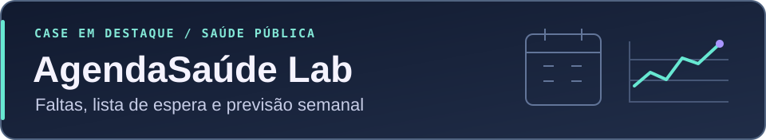

Sou estudante de **Ciência da Computação** e concluí a formação em **Ciência de Dados pela EBAC**. Desenvolvo projetos que conectam análise de dados, avaliação de modelos e aplicações interativas, principalmente em saúde pública e logística.

[LinkedIn](https://www.linkedin.com/in/jo%C3%A3o-vitor-m-91229b26a/) · [E-mail](mailto:jvmarinhocosta@gmail.com) · [Todos os repositórios](https://github.com/jvickz?tab=repositories)

## Projetos selecionados

**[AgendaSaúde Lab](https://github.com/jvickz/agendasaude-lab)** — Simulador de agendamentos municipais que combina faltas, lista de espera e previsão semanal. O projeto compara o modelo com a média das quatro semanas anteriores para avaliar o ganho sobre uma regra simples.

- **[RecompraLab](https://github.com/jvickz/recompralab)** — Experimento de machine learning para prever recompra, com avaliação temporal e teste interativo.
- **[RotaLab](https://github.com/jvickz/rotalab)** — Simulador logístico em C++ e WebAssembly para comparar rotas e testar o efeito de mudanças no trânsito.
- **[Entrega em Foco](https://github.com/jvickz/entrega-em-foco)** — Análise de 2.637 viagens, painel executivo e proposta de piloto para avaliar um critério de prontidão das entregas.

## Ferramentas e estudos

- **Dados e modelagem** · Python, SQL, MySQL, Jupyter e R
- **Desenvolvimento** · JavaScript, HTML, CSS, C, C++ e Git
- **Em estudo** · Java, orientação a objetos e segurança da informação

[Exercícios da formação em Ciência de Dados](https://github.com/jvickz/Projetos-em-JUPYTER) · [Instagram](https://www.instagram.com/jvickz7/)
